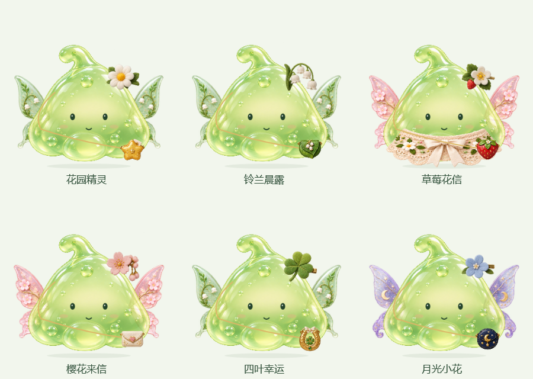

# 咕叽 Guji · 住在桌面上的小精灵

咕叽是一只透亮、软乎乎的绿色史莱姆。它戴着小花、扑着薄薄的翅膀，背着装有秘密纸条的星星包，陪你在电脑前度过学习、工作和休息的时间。

你可以摸摸它、把它轻轻提起来，给它换衣服、挑杯子、喂一顿饭。忙起来忘了喝水、吃饭或休息时，它也会用可爱的气泡提醒你。

<p align="center"></p>

这个项目从一份送给朋友的小礼物开始。我负责形象、功能与互动体验的设计，借助 AI 辅助完成素材和程序实现，再根据实际试用反馈，慢慢调整它的穿搭、动作和生活细节。

## 咕叽能给你带来什么

| 日常时刻 | 咕叽会怎样陪着你 |
| --- | --- |
| 忙得忘记喝水 | 按你设置的间隔提醒喝水，还能选一只喜欢的小杯子，和它一起咕嘟咕嘟。 |
| 到了饭点还在电脑前 | 在早餐、午餐和晚餐时间提醒吃饭。给咕叽挑一道菜、喂上一口，也提醒自己好好吃饭。 |
| 坐了很久 | 到时间提醒活动一下，陪它伸个懒腰，给自己留一点离开屏幕的时间。 |
| 晚上还舍不得休息 | 按你设定的睡前时间提醒早睡；给它铺小床、关小灯，让一天有一个温柔的收尾。 |
| 刚打开电脑 | 启动时按时段问候你；需要的话，可以在设置中开启随 Windows 启动。 |
| 想短暂放松 | 摸摸、戳戳、抱抱，试一套新穿搭，或看看星星包里的小纸条。 |

提醒时间可以按自己的作息修改，也支持稍后提醒和暂停。专注、全屏和睡觉时，咕叽会保持安静；错过的提醒不会堆积补发。

## 花园精灵与小衣橱

**花园精灵是咕叽最初、也最喜欢的一身装扮：小雏菊、晨露般的薄绿翅膀，加上藏着小秘密的星星包。**

小衣橱里还有铃兰、草莓、樱花、四叶草和月光小花等花园搭配。不同的小花、薄翼与包包，可以换出不同的小精灵模样。



目前共有 **21 套穿搭**。头饰、翅膀、衣服和包包可以分别挑选，自由搭配、保存收藏，也可以指定一套睡衣；叫醒咕叽后会恢复白天的穿搭。

秋装和睡衣采用贴合身体的单层披衣，领口露出表情，拉扯时跟着果冻身体一起变形。

<details>
<summary>看看秋装和睡衣</summary>


焦糖格纹、苔绿针织、燕麦暖秋、枫叶棉披风，以及云朵、蜜桃、星星和薄荷睡衣，都能与帽子单独搭配。

</details>

## 和它一起好好吃饭、喝水

咕叽的菜单里有 **38 种日常食物**，分成家常菜、主食、小吃和水果甜点。

麻辣烫、红烧肉、红烧排骨、番茄炒蛋、牛肉面、饺子、炸鸡、小蛋糕……挑好后，把食物拖到嘴边，或点击食物，就能喂它吃饭。吃完脸上如果粘了小米粒，还可以点一下帮它擦干净。


另有 **6 款小杯子**可以选择，也能跟随穿搭换杯子。提醒喝水时，可以点“一起喝水”，让小互动成为忙碌间的一次停顿。[查看完整的 38 道美食](app/38道美食.txt)。

## 给一天留一个晚安仪式

打开小窝，给咕叽铺好叶子小床。它会换上你选的睡衣，钻进被子里；点一下床头小灯，灯光慢慢熄灭，咕叽就睡觉了。再点灯可以叫醒它。


床头灯亮度支持 **20%～150%** 调节，位置在 设置 → 活动与显示。睡前提醒时间也可以按自己的作息修改。

## 桌面上的小互动

| 操作 | 会发生什么 |
| --- | --- |
| 按住身体轻轻拉动 | 先有一点黏性和拉伸，再整只提起来；提起后跟随鼠标移动，放手回弹。 |
| 轻轻划过身体 | 摸摸它，看它开心地眯起眼睛。 |
| 单击 / 双击 | 戳戳 / 抱抱。 |
| 点击小屋叶子，或右键 | 打开小窝、衣橱、食物、杯具和设置。 |
| 点击星星包 | 打开秘密纸条；也可以从小窝或右键菜单进入。 |
| 修改名字与称呼 | 给小伙伴起自己的名字，也决定它怎样称呼你。 |
| 打开托盘菜单 | 隐藏、找回或退出咕叽。 |

咕叽偶尔会在屏幕上走几步，自主散步频率可以调整或关闭。窗口背景透明，大小支持 40%～150%，说话使用淡薄荷绿半透明气泡，让它自然地待在你的桌面上。

## 运行

面向常见 Windows 10 / 11 Intel、AMD 电脑，需要系统已有 .NET Framework 4.6 或更新的 4.x 运行环境。

下载便携压缩包后，**完整解压，再双击 Guji.exe**。assets 文件夹和 Guji.exe.config 必须保留在程序旁。运行不需要 Python、Node 或开发工具。

设置保存在程序旁的 data/settings.xml；错误日志、测试结果保存在程序旁的 work/。首次使用建议放到 E 盘等可写目录。不同版本不能同时运行；请先从托盘退出旧版。

仓库里的源码 ZIP 不是可运行安装包。可用下述脚本自行构建并打包。

## 从源码构建

在 Windows PowerShell 中进入仓库目录，执行：

```powershell
powershell -NoProfile -ExecutionPolicy Bypass -File .\build.ps1
```

脚本使用系统 .NET Framework C# 编译器，首次下载并校验微软官方 .NET Framework 4.6 参考程序集；依赖和临时文件均写入仓库所在磁盘。建议将项目克隆到 E 盘。

生成程序位于 app/Guji.exe。构建并运行现有自检：

```powershell
powershell -NoProfile -ExecutionPolicy Bypass -File .\build.ps1 -Test
```

生成不包含个人设置、缓存和测试记录的便携包：

```powershell
powershell -NoProfile -ExecutionPolicy Bypass -File .\scripts\package.ps1 -Test
```

输出位于 dist/，详情见 [构建说明](docs/BUILD.md)。

## 修改纸条

打开 设置 → 名字与称呼 → 星星纸条，填写内容后保存。源码版使用通用示例文案，不包含送朋友版本的私人纸条。

## 项目结构

```text
app/src/       C#、WPF 窗口、互动、设置与自检
app/assets/    透明图集与宠物素材
scripts/       依赖恢复和便携打包
docs/         使用说明、架构说明和截图
```

技术栈：C#、WPF、.NET Framework 4.6，使用 WPF 绘图与网格映射实现局部形变。

## 当前状态

这是持续迭代中的个人项目。已有自动模型、界面按钮、素材与便携包检查；自检计数含循环素材项，不表示相同数量的独立功能都已人工验收。

真实拖动手感还在迭代，朋友电脑、独立干净 Windows 环境和多屏 DPI 尚未完成验证。欢迎反馈操作步骤、系统版本和截图，提交前请检查截图与日志中的个人信息。

## 素材与许可

项目形象和服装、道具素材使用 AI 辅助生成，并在程序中切片组合。见 [素材说明](docs/ASSETS.md)。本项目暂未指定开源许可证。
