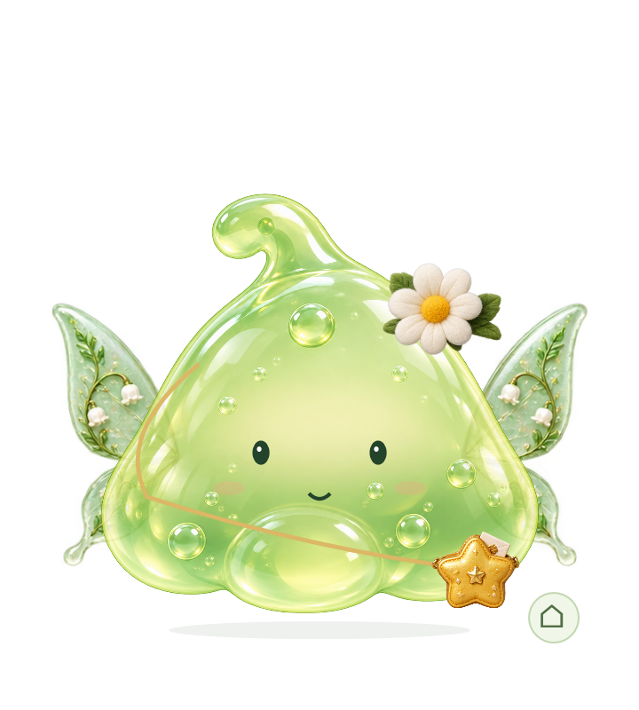
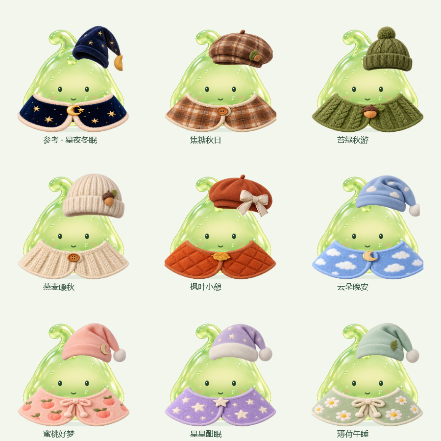
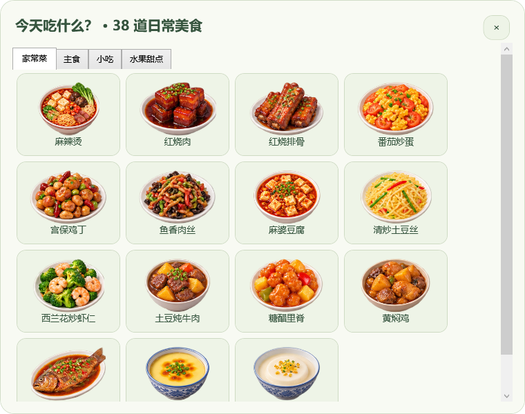
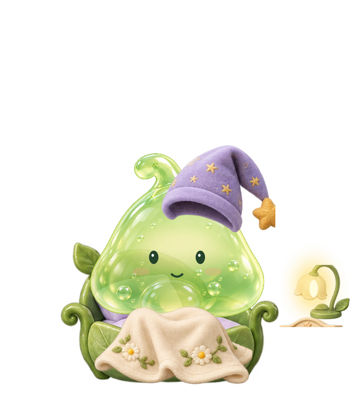

# 咕叽 Guji

一个可以捏捏、换装、喂饭，也会陪你休息的绿色史莱姆 Windows 桌面宠物。

咕叽从一份送给朋友的小礼物开始。我负责形象、互动体验与功能设计，借助 AI 辅助完成素材和程序实现，再根据实际试用持续调整。

<p align="center"></p>

## 能做什么

- 透明桌面窗口、果冻质感；短拉后提起，拖动时拉伸，放手回弹。
- 摸摸、戳戳、双击抱抱；偶尔在屏幕上短距离散步。
- 21 套穿搭，头饰、翅膀、衣服、包包可单独搭配，收藏搭配并设置睡衣。
- 38 种日常食物，分类选择后拖到嘴边或点击喂食。
- 6 款杯具、喝水互动，以及喝水、三餐、活动和睡前提醒。
- 叶子小床、关灯入睡、叫醒换回日常衣服；床头灯亮度可调。
- 自定义宠物名字、主人称呼和星星包里的纸条。
- 托盘隐藏与找回、可选开机启动；睡眠、专注和全屏时安静陪伴。

## 预览

### 单层衣橱



### 日常食物与睡觉




## 运行

面向常见 Windows 10 / 11 Intel、AMD 电脑，需要系统已有 .NET Framework 4.6 或更新的 4.x 运行环境。

下载便携压缩包后，**完整解压，再双击 Guji.exe**。assets 文件夹和 Guji.exe.config 必须保留在程序旁。运行不需要 Python、Node 或开发工具。

设置保存在程序旁的 data/settings.xml；错误日志、测试结果保存在程序旁的 work/。首次使用建议放到 E 盘等可写目录。不同版本不能同时运行；请先从托盘退出旧版。

仓库里的源码 ZIP 不是可运行安装包。可用下述脚本自行构建并打包。

## 从源码构建

在 Windows PowerShell 中进入仓库目录，执行：

```powershell
powershell -NoProfile -ExecutionPolicy Bypass -File .\build.ps1
```

脚本使用系统 .NET Framework C# 编译器，首次下载并校验微软官方 .NET Framework 4.6 参考程序集；依赖和临时文件均写入仓库所在磁盘。建议将项目克隆到 E 盘。

生成程序位于 app/Guji.exe。构建并运行现有自检：

```powershell
powershell -NoProfile -ExecutionPolicy Bypass -File .\build.ps1 -Test
```

生成不包含个人设置、缓存和测试记录的便携包：

```powershell
powershell -NoProfile -ExecutionPolicy Bypass -File .\scripts\package.ps1 -Test
```

输出位于 dist/，详情见 [构建说明](docs/BUILD.md)。

## 修改纸条

打开 设置 → 名字与称呼 → 星星纸条，填写内容后保存。源码版使用通用示例文案，不包含送朋友版本的私人纸条。

## 项目结构

```text
app/src/       C#、WPF 窗口、互动、设置与自检
app/assets/    透明图集与宠物素材
scripts/       依赖恢复和便携打包
docs/         使用说明、架构说明和截图
```

技术栈：C#、WPF、.NET Framework 4.6，使用 WPF 绘图与网格映射实现局部形变。

## 当前状态

这是持续迭代中的个人项目。已有自动模型、界面按钮、素材与便携包检查；自检计数含循环素材项，不表示相同数量的独立功能都已人工验收。

真实拖动手感还在迭代，朋友电脑、独立干净 Windows 环境和多屏 DPI 尚未完成验证。欢迎反馈操作步骤、系统版本和截图，提交前请检查截图与日志中的个人信息。

## 素材与许可

项目形象和服装、道具素材使用 AI 辅助生成，并在程序中切片组合。见 [素材说明](docs/ASSETS.md)。本项目暂未指定开源许可证。
